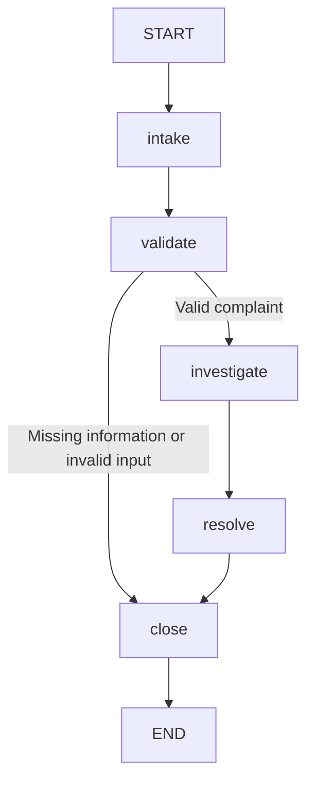

# Lab Proof: B2B Order Exception and Complaint Triage

## Workflow

This project uses a LangGraph state machine to process B2B order complaints. The intake node uses an LLM with structured output to classify the complaint and extract an explicitly stated order ID. Validation and business decisions use deterministic rules. Investigation checks a small local sample order dataset and records the evidence used for the recommendation.

## Valid case

**Input complaint**

> Order ORD-1042 arrived later than promised. Please investigate the delivery delay.

**Workflow path**

`intake -> validate -> investigate -> resolve -> close`

**Evidence used**

- Order `ORD-1042` is recorded as delivered.
- Promised delivery date: `2026-10-24`.
- Actual delivery date: `2026-10-28`.
- The calculated delay is 4 calendar days.
- The sample policy flags deliveries that arrive more than 2 calendar days late for review.

**Final output**

> Draft — human review required.
> Category: delivery_delay
> Order ID: ORD-1042
> Investigation evidence:
> - Order ORD-1042 status: delivered.
> - Promised delivery date: 2026-10-24.
> - Actual delivery date: 2026-10-28.
> - Policy checked: If an order arrives more than 2 calendar days after its promised delivery date, flag it for review.
> - Calculated delivery delay: 4 day(s).
> Recommended resolution: The delay is supported by the order dates. Review the case for an appropriate service recovery.

The evidence comes from the project's local sample data and policy; the workflow does not connect to a real order-management system.

## Invalid case

**Input**

An empty complaint.

**Observed result**

- Workflow path: `intake -> validate -> close`
- Final status: `rejected`
- The investigation node was skipped.
- Final message: `Closed: the complaint did not pass validation.`

This confirms that invalid input follows a different route from a valid complaint.

## Limitation

The workflow flags cases for human review but does not implement a real approval step that pauses and resumes the graph. The order records and policy are also local examples, so the workflow has not been validated against a live business system.

## LangGraph compared with a freeform LangChain agent

In this project, LangGraph makes the workflow path, shared state, and conditional routing explicit. That makes it easier to inspect why a case was investigated, closed, or escalated.

A freeform LangChain agent can have more flexibility to choose tools and actions, but its route can be less predictable unless additional constraints and checks are added. This comparison is about the structured LangGraph workflow used here and a freeform agent design; LangChain can also be used to build structured workflows.
